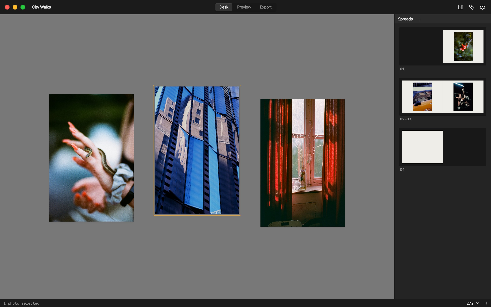

# Sequence

Sequence lays out photos as a book (spreads of facing pages) or a run of frames (slides, an
Instagram carousel), and exports them as a PDF, images, an InDesign file, or an Instagram
post. It's a web app at [sequence.photos](https://sequence.photos/app/) and a Mac app on the
App Store, built from the same code.



This README is for working on it. What the app does, in detail, is in
[docs/agent-context/](docs/agent-context/).

## Setup

You need Node 24 (`.nvmrc`; anything from 20.19 works). For the Mac app, also Rust and the
Xcode Command Line Tools: [docs/setup.md](docs/setup.md) has the details for a new machine.

```bash
nvm use
npm ci
npm run setup   # the server's packages, and Playwright's browsers for test:e2e
```

## The site

The website: the landing page, the app at `/app/`, and the privacy and support pages, all
in `site/`. The app's code is in `src/`.

```bash
npm run dev       # http://localhost:5175 (the app is at /app/), reloading on changes
npm run build     # type-check, then build to dist/
npm run preview   # serve dist/ at http://localhost:4173
```

Netlify deploys it (`netlify.toml`): every push to `main` goes to sequence.photos, after
`npm test && npm run build`; pull requests get a preview deploy.

Public settings (the domain, the App Store link, the server's address) are in `.env`, which
is committed. Never put a secret there: see [Secrets](#secrets).

## The server

Posting to Instagram goes through a Cloudflare Worker in `server/`, a package of its own.
[server/README.md](server/README.md) describes what it does, its API, and its setup. The
app imports its API types from `server/src/api.ts`.

```bash
npm run server:dev          # a local Worker at http://localhost:8787 (the dev environment)
npm run server:deploy       # deploy to production
npm run server:deploy:dev   # deploy the dev environment
npm run server:metrics      # a usage report from Cloudflare's analytics
```

The local Worker reads its secrets from `server/.dev.vars` (copy `.dev.vars.example`);
the deployed ones are set by the owner with `wrangler secret put`. Settings → Advanced in
the app switches between the production, dev, and local servers.

## The Mac app

A [Tauri](https://tauri.app) app in `src-tauri/`, wrapping the same web app with a menu
bar, Save dialogs, and `.photo-sequence` files as documents. It runs sandboxed, as on the
App Store, local builds too.

```bash
npm run app:dev     # run it, reloading on changes (the first build takes a few minutes)
npm run app:build   # a standalone build: src-tauri/target/release/bundle/macos/
npm run app:store   # a signed, universal .pkg for App Store Connect (and uploads it)
```

`app:dev` and `app:build` run `app:ui:dev` and `app:ui:build`, the app's web side, on their
own. `app:store` needs certificates and a provisioning profile, and says what's missing;
usually the Release workflow does it instead: see [docs/releasing.md](docs/releasing.md).

The website and the app share everything but `src/platform/`: each build imports
`#platform`, which is `src/platform/browser.ts` for the website and `src/platform/macos/`
for the app (see `vite.config.ts`). CI checks that neither build contains the other's code.

## Testing

```bash
npm test              # unit tests (vitest); test:watch re-runs them on save
npm run test:e2e      # interaction tests in Chromium and WebKit (Playwright)
npm run test:app      # the Mac app end to end: files, windows, the sandbox (a few minutes)
npm run server:test   # the server's tests
npm run check         # before a commit: secrets, formatting, lint, types, unit tests
```

`test:app` builds a test version of the Mac app and drives it on fixture projects (its
window shows for a while), keeping its storage apart from the real app's.

CI (`.github/workflows/`) runs the checks, both builds, and the e2e tests on every pull
request, and `test:app` on a Mac when a change touches the Mac side. Before a release, go
through [docs/testing.md](docs/testing.md): what's automated and what to check by hand.

## Secrets

Secrets live only in files whose names are git-ignored everywhere in the repo:
`.env.local` (or `.env.*.local`) and the server's `.dev.vars`. Committed `.env` files hold
public `VITE_` values only, since they ship in the website and the app;
`scripts/check-env.mjs` checks that in `npm run check` and CI.

## Directories

| Directory    | What's in it                                                                                    |
| ------------ | ----------------------------------------------------------------------------------------------- |
| `src/`       | The app: React and TypeScript, with its unit tests beside each file                             |
| `site/`      | The website's pages (landing, app, privacy, support), the landing page's code, and public files |
| `server/`    | The Cloudflare Worker for Instagram posting, with its own package and tests                     |
| `src-tauri/` | The Mac app's native side (Rust), its config, entitlements, and icons                           |
| `e2e/`       | Playwright interaction tests                                                                    |
| `scripts/`   | Build and release scripts: the App Store build, version bump, icons, checks                     |
| `assets/`    | Source art: the app icon's drawings (`npm run icons` makes the rest)                            |
| `docs/`      | Setup, testing, releasing, design proposals, and context for coding agents                      |
| `.github/`   | CI, the Mac app test, and the release and App Store workflows                                   |
